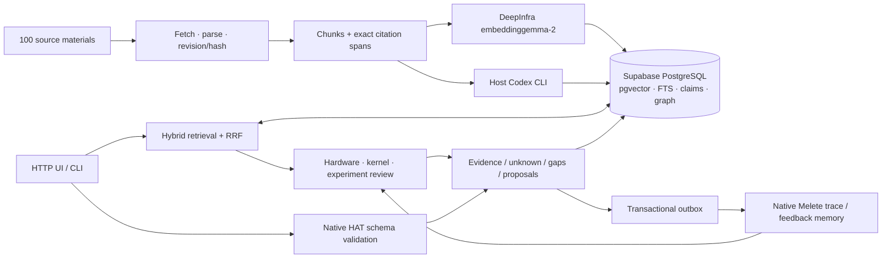
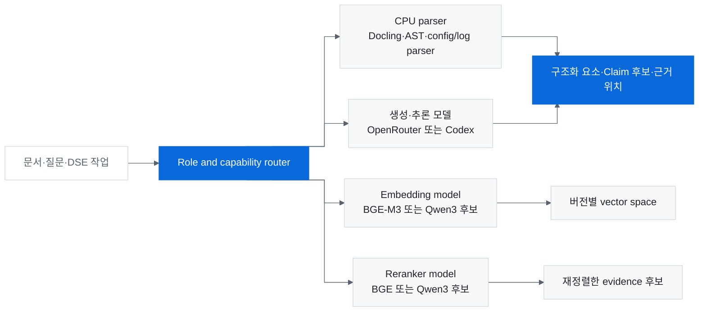
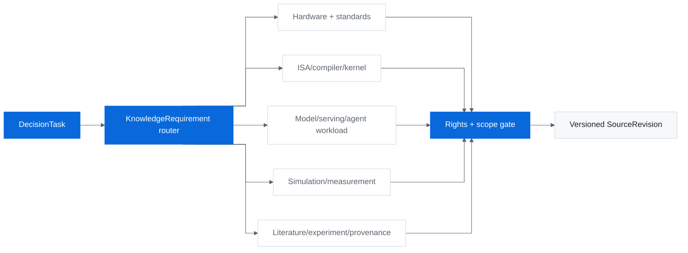
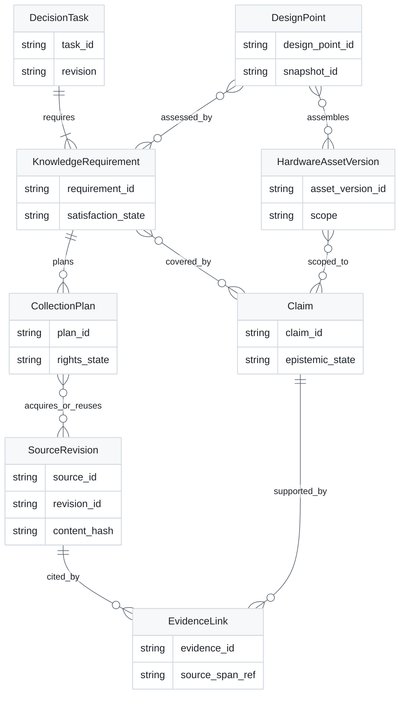
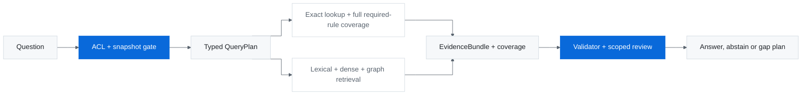

# DSE Knowledge Workbench — 지식·설계 판단·경험 환류

상태: **100개 자료 P1 runtime 실제 구축·연결·E2E 검증 완료** · 기준일: 2026-10-25 KST. 아래 P1 표가 실제 구현 범위이며, 나머지 architecture/scenario는 확장 설계다. 145,748건은 수집 대상 목록이고 그 전체를 본문 분석·KG 등록한 상태는 아니다.

이 README는 DSE 결정별 지식 요구를 만들고, 허가된 source에서 evidence를 취득·구조화하며, hardware/kernel/experiment 결정에 쓰고 부족한 지식을 다시 수집하는 전체 구조를 설명한다. 2026-10-18 사용자 정정에 맞춘 상위 기준은 [2026-10-21-dse-knowledge-architecture.md](https://github.com/jimmylegendary/dse-knowledge/blob/docs/p0-episode-contracts/docs/superpowers/specs/2026-10-21-dse-knowledge-architecture.md)와 [2026-10-21-knowledge-architecture-plan.md](https://github.com/jimmylegendary/dse-knowledge/blob/docs/p0-episode-contracts/docs/superpowers/plans/2026-10-21-knowledge-architecture-plan.md)다. 이전 HAT native episode/adapter 계약은 세부 참고이며 이 architecture의 중심 gate가 아니다.

## 실제 P1 — 100개 자료로 전체 경로를 확인

Linux host에서 HTTP UI와 CLI를 실행하고 기존 Supabase project에 정본·검색·KG·job을 보존한다. 공개 원문 100개를 확보해 **1,912 chunks / 768차원 실제 embedding**을 저장했다. **99개 자료에서 Claim 101개·Entity 198개·Edge 101개**를 생성했다. 목차로 구성된 1개 자료는 검색 가능한 reference로 남기고 Claim을 만들지 않았다. Claim은 발췌에서 원문 인용과 절대 offset을 검증한 `source_assertion`이다. 원문 전체의 과학적 타당성을 검증한 결과는 아니다.



| 기능 | 실제 P1 경로 | 결과의 상한 |
|---|---|---|
| Insert | `sample → acquire → index → extract` CLI, 9개 분야 quota, 공개 원문·hash·revision·offset | 접근 실패·abstract-only는 전문 자료로 포함하지 않음; extraction은 기본 4개 분산 발췌(각 900자), 기본 1 claim/자료; 설정 상한 8개·각 1,400자·3 claims |
| Read | UI 자료 목록·상세·인용, lexical + dense + exact + source-linked graph의 RRF | ranking은 근거 탐색이며 물리적 가능성의 증명이 아님 |
| KG | PG의 Claim·Entity·Edge와 원문 연결, graph UI | P1 entity는 `concept` 분류; 관계/Claim kind와 source scope 보존. 정교한 HW ontology는 후속 해상도 |
| DSE 판단 | 실제 Codex job, hardware/kernel/experiment 질문, citation whitelist, snapshot·gap·다음 제안 | 설계·kernel 제안은 실행·정확성·성능 검증 전 |
| 필수 규칙 | 검색 top-k와 독립적인 전체 arithmetic rule 검사 | 제공된 숫자·단위의 연산만 검사; authority·physical feasibility는 미검증 |
| 실험 | MetricVector 입력, 단위 정규화·cohort/method 검사·Pareto 비교 | 사용자 입력값 비교; HAT 성능 실행이나 B300 실측을 생성하지 않음 |
| HAT | host의 실제 `hat-schema` 구조 검증 | component/assembly는 bundle 필요; committee·runtime simulation은 아직 미연결 |
| Melete | 실제 native observe/query, canonical feedback·outbox·receipt | assistant 판단은 현재 native gate상 `trace_only`; user feedback의 검색 가능 여부는 실제 receipt로 구분 |
| 복구 | durable jobs, 안정 decision ID, 단일 worker lock, outbox 재시도, local logical backup | 단일 host/process; off-host backup·PostgreSQL 재해복구·HA는 미검증 |

브라우저: host에서 `http://127.0.0.1:8080`. LAN 접근 주소는 실행 host의 IP와 같은 port를 사용한다. 현재 profile은 단일 운영자용 HTTP self-host다. UI에 로그인·사용자별 권한 경계는 없으며 다중 사용자 배포 검증은 별도다.

100개 목록과 공개 metadata/hash는 [manifest.json](https://github.com/jimmylegendary/dse-knowledge/blob/main/research/pilot100/manifest.json)에 보존한다. 본문·embedding·모델 응답·private 설정은 public Git에 올리지 않는다.

### 실제 검증 결과 — 2026-10-25

| 검증 | 실제 결과 | 해석 |
|---|---|---|
| Corpus/원문 연결 | 100 artifact hash · 1,912 chunk span · 101 quote/offset 검사 통과, 끊긴 graph reference 0 | 원문 인용의 정합성 확인; 과학적 사실 검증과 구분 |
| Offline suite | `pytest -q`: 148 passed, deprecation warning 1 | env/provider/citation/retrieval/policy/API/recovery/운영 회귀 |
| 실제 HTTP E2E | 18/18 gates 통과 | 실제 Supabase·embedding API·Codex·native HAT schema·Melete 사용 |
| Hardware 판단 | `constraint_rejected`, 인용 4개 | 필수 arithmetic rule 13개 중 13번째 위반을 검색 top-k와 무관하게 거부 |
| Kernel 판단 | `insufficient_evidence`, 인용 3개 | 확인된 근거와 미지원 ISA/정확성/성능 검증 gap을 분리 |
| Experiment 판단 | `insufficient_evidence`, 인용 3개 | MetricVector 조건·tradeoff·추가 실험 제안; B300 수치 추측 없음 |
| Melete 환류 | user feedback 저장·검색, 다음 experiment snapshot에서 동일 memory 참조 확인 | assistant 판단은 native `trace_only` 유지 |
| 재시작/재전달 | 동일 decision ID 복구, 추가 LLM 호출 0; feedback 재전달 시 동일 memory ID·정본 receipt 유지 | 제어된 재시작/재전달 시험; 실제 네트워크 장애 주입은 아님 |
| Browser | desktop 1440 / mobile 390·375의 22개 화면 상태, overflow·HTTP/network/console/page 오류 0 | 검색·인용·graph·판단 이력/상세·시스템 상태 확인 |
| Local snapshot | 15개 table 행 직렬화·SQLite 행 수/무결성 smoke 통과 | 전체 제품 복구나 PostgreSQL restore 검증은 아님 |

코드/공개 집계는 [verification.json](https://github.com/jimmylegendary/dse-knowledge/blob/main/research/pilot100/verification.json)에 있다. 실제 3개 판단은 모두 tool call 0인 결과만 저장했다. 초기 시험 중 timeout·host tool 설정 혼입은 실패로 남겼고, per-call instruction/skill/MCP 설정을 격리한 뒤 같은 미완료 job ID를 재시도했다. Codex의 JSONL이 backend model revision을 보고하지 않아 model ID는 요청 설정값으로 기록한다.

자료 적합성은 별도 과제다. 100개 제목·요약·앞 700자를 Jev로 보조 검토했으며, 56개는 직접 DSE, 35개는 보조 방법론, 9개는 navigation 유사 자료로 표시됐다. 앞부분만 본 분류이므로 RISC-V 소개·API 설명·설치 version mapping처럼 실제 본문이 있는 자료도 flag된다. 이 수치를 전체 본문 품질 인증으로 사용하지 않는다. 문서/운영 reference가 섞인 pilot이며, 14만건 확장 전 source 역할 분류와 적합성 평가를 강화한다.

### 품질·검색·규모 평가 — 2026-10-25

**판정: 현재 100개 Workbench는 계속 사용하면서 개선할 수 있다. 145,748건의 전면 KG 생성은 보류한다.** 아래 값은 고정된 P1과 편의·분야별 표본의 관측이며 전체 corpus 정확도나 처리량 보장이 아니다. 평가 중 source/Claim/검색/model 설정은 바꾸지 않았다.

| 평가 | 실제 결과 | 해석 |
|---|---|---|
| 자료 100개 역할 | 핵심기술 35 · 보조방법 29 · 운영/연동 30 · 목차 5 · 범위밖 1 | 같은 retrieval·판단 목적으로 모두 사용하면 안 됨. 역할 분류는 평가 artifact이며 정본에는 아직 미반영 |
| Claim 101개 | 명확한 원문지지 99 · 조건/요약 보완 2 · 불지지 0, quote/offset 101/101 | AI 보조 문맥 검토. 논문 주장의 독립 과학 검증은 0이며, 두 보완 건도 원문 의미가 틀렸다는 판정은 아님 |
| Graph | 198 nodes · 101 edges · 97개 연결 묶음, 최대 4 nodes, 여러 자료가 연결된 묶음 3 | entity는 모두 concept, relation 92종. 약 1 Claim/자료의 얇은 graph로 모든 DSE 단계의 typed reasoning을 약속하지 못함 |
| 정답 자료 Hit@5 | Hybrid 24/24, dense 24/24 | 결과를 보기 전에 만든 부분 정답 기준. 검색 정확도 100%라는 뜻이 아님 |
| 정답 자료 Hit@1 / MRR | Hybrid 16/24·0.814, dense 23/24·0.979 | graph를 합치면 원래 정답 자료의 첫 순위가 내려가는 사례가 있음. 최종 답변 정확도 비교는 별도 |
| 지정 근거 chunk Hit@5 | Hybrid 14/24, dense 10/24 | graph가 일부 근거 위치를 더 찾음. 반면 놓친 10건의 사후 AI 검토는 관련 대체 passage 6 · 부분 근거 3 · 핵심 메커니즘 누락 1; 이를 새 gold/precision으로 승격하지 않음 |
| Lexical / exact | 30건 모두 후보 0 | 전체 자연어 질문을 AND 조건·title substring으로 쓰는 방식의 한계. Query decomposition·task별 fusion/reranking 실험 필요 |
| Blind 판단 3건 | 정상 source 질문 2/2 완료, B300 미지원 실측 질문 1/1 unknown, 수치 날조 0 | 두 factual 질문과 한 미지원 질문의 AI 보조 검토. 6개 미지원 질의 전부의 최종 답변을 평가한 것은 아님 |
| 검색 지연 | 실제 Retriever 30건 p50 8.62s / p95 12.11s; HTTP 6건 p50 9.06s / p95 15.41s | 성공 요청 기준의 작은 순차 표본. Embedding median 8.00s, DB 네 질의 합 median 0.49s; saturation 시험 아님 |
| 100개 embedding | 1,956,001 input tokens, 현재 단가 적용 추정 $0.03912 | provider invoice가 아니며 overlap·반복 title 등 실제 usage에 포함된 입력 기준 |
| 생성 처리량 | 기록된 추출 성공 96호출의 합계 2,767.51s, p50 27.50s | 실패 usage 누락·수동 대기·전체 coordinator 비용을 포함하지 않은 하한. CLI token을 API 청구액으로 환산하지 않음 |
| 145,748건 가정 | 약 279만 chunks · 원문 artifact 132GB · 현 layout PG schema 약 58GB; ideal 4-worker 생성 약 11.7일 | 같은 자료 크기/추출 깊이의 선형 scenario. 현재 host 여유 약 58GB는 원문 예상량보다 작고 quota·대형 index·실패 재시도·더 깊은 추출은 미검증 |

Embedding 비용의 기준은 [DeepInfra 공식 단가](https://deepinfra.com/google/embeddinggemma-2/api)의 $0.020 / 1M tokens다(2026-10-25 확인). 같은 분포의 전체 문서 embedding scenario는 약 $57이지만, 생성·review·DB·storage 비용 전체를 뜻하지 않는다.

정답셋은 24개 정상 질의(한국어/영어 각 12, 9개 category마다 최소 2개)와 6개 미지원 질의로 먼저 고정했다. Unsupported의 source 참조는 근접 문맥을 설명하는 boundary이지 정답이 아니다. 미지원 질의에서 검색 결과가 나오는 것만으로 실패로 처리하지 않는다. 한국어와 영어 질문이 서로 달라 subgroup 차이를 embedding의 언어 성능 차이로 단정하지 않는다.

초기 판단 probe 3개는 입력 case ID의 pos/neg prefix가 모델에 보여 독립 평가에서 제외했다. 같은 질문을 공통 kind=knowledge, model-visible input={}로 다시 실행했고 **blind 결과 3개만** 위 성적에 사용했다. 기존 결과는 지우지 않고 invalidation audit와 함께 보존했다. 새 gold feedback은 Melete에 추가하지 않았다. 재현 helper는 metadata·expected label을 model input에 싣지 않는 회귀 테스트를 가진다.

169건 acquisition 시도 중 69건은 allowlist 63 · revision pin 4 · 크기 제한 2로 제외됐다. 이를 전체 자료의 원문 접근 가능률로 해석하지 않는다. source metadata의 title/abstract origin과 실제 PDF fulltext revision도 구분한다. 예를 들어 Glacierware는 abstract-origin catalog record지만 실제 PDF를 확보했다. Lithography hotspot은 thermal hotspot과 다르므로 category 보완 대상으로 기록했다.

| 다음 보완 우선순위 | 전체 제품에서 높일 해상도 |
|---|---|
| 1. Write 품질 | source 역할/지식 수요별 수집·사용 정책, Claim의 값·단위·대상 revision·적용 조건, 조건부 연구결과의 scope 보존 |
| 2. KG와 read | typed entity/관계·alias·source 간 연결, 핵심어 분해, 역할별 검색·근거 reranking/이웃 문맥 확장; 현재 30개는 회귀용으로 두고 새 held-out/번역쌍도 평가 |
| 3. 규모 검증 | artifact 공간, durable batch/재개·quota·budget·대형 index를 확인하면서 같은 UI→DSE 판단→feedback 여정으로 1,000개 수준 재평가 |

공개 재현 자료: [평가 집계](https://github.com/jimmylegendary/dse-knowledge/blob/main/research/pilot100/evaluation-2026-10-25.json), [자료별 역할](https://github.com/jimmylegendary/dse-knowledge/blob/main/research/pilot100/source-roles-2026-10-25.json), [본문/quote를 제외한 qrels](https://github.com/jimmylegendary/dse-knowledge/blob/main/research/pilot100/retrieval-cases-2026-10-25.json). 실제 채팅 답변·source 본문·query vector·credential은 공개하지 않는다.

```bash
"$HOME/.local/share/dse-knowledge/app-venv/bin/python" scripts/evaluate-pilot.py --cases research/pilot100/retrieval-cases-2026-10-25.json --output "$HOME/.local/share/dse-knowledge/qa/evaluation-next/retrieval-results.json"
"$HOME/.local/share/dse-knowledge/app-venv/bin/python" scripts/evaluate-decision-probes.py --cases research/pilot100/retrieval-cases-2026-10-25.json --case-id pos-compiler-en-fused-attention --case-id pos-serving-en-blockserve --case-id neg-ko-b300-serving-measurement --output "$HOME/.local/share/dse-knowledge/qa/evaluation-next/decision-probes.json"
```

두 command는 같은 100개 source snapshot이 적재된 runtime에서 실제 provider를 호출한다. Public qrels는 본문 quote를 hash로 대체한 projection이므로 original frozen private qrels SHA와 파일 SHA는 다르다. 평가 helper는 현재 24/6 구성을 검증하며, 이 결과를 HAT 실행·kernel correctness·physical feasibility·B300 우월성 평가로 해석하지 않는다.

### 실행과 설정

Python 3.12+, `uv`, 기존 Supabase project, 로그인된 host Codex CLI, 선택된 embedding API가 필요하다. `uv.lock`으로 Python dependencies를 고정한다.

```bash
UV_PROJECT_ENVIRONMENT="$HOME/.local/share/dse-knowledge/app-venv" uv sync --frozen --extra test --python 3.12
# owner-only 설정을 준비한 뒤 기존 project에 schema/최소권한 role을 설정한다.
"$HOME/.local/share/dse-knowledge/app-venv/bin/python" scripts/bootstrap-database.py
"$HOME/.local/share/dse-knowledge/app-venv/bin/dse-knowledge" serve
```

| 설정 파일 | 필요한 항목 | 보관 |
|---|---|---|
| `database.env` | 기존 Supabase pooler의 관리자 user/password, DB/schema, `verify-full`, 공식 CA 경로 | `~/.config/dse-knowledge`, 디렉터리 0700·파일 0600; bootstrap 전용 |
| `runtime-database.env` | bootstrap이 생성한 `dse_knowledge_app.<ref>` 전용 자격증명 | HTTP runtime은 관리자 DB 설정을 사용하지 않음 |
| `llm.env` | `CHAT_PROVIDER=codex_cli`, `CHAT_MODEL_ID=gpt-6.1-sol`, reasoning `max`, `CODEX_EXECUTABLE`, `CODEX_WORKDIR`, `CHAT_TIMEOUT_SECONDS` (1–600초; 기본 180초, 현재 profile 360초) | API key 복사 없이 기존 host CLI 로그인 사용 |
| `embedding.env` | `EMBEDDING_PROVIDER=deepinfra`, `EMBEDDING_MODEL_ID=google/embeddinggemma-2`, 768차원, API key | document/query task 분리, provider의 task prefix 사용 |
| `app.env` | data/artifact root, bind/port, extraction batch 1–5·발췌 2–8·발췌 길이 100–1,400·claim 1–3 | 기본 bind는 loopback; 현재 host profile은 `0.0.0.0:8080` |

실제 지원하는 설정 예시는 [config.env.example](https://github.com/jimmylegendary/dse-knowledge/blob/main/deploy/config.env.example)에 있다. 이 P1은 Codex CLI + DeepInfra adapter 조합을 실행한다. OpenRouter·다른 model/embedding/reranker는 architecture 후보이며 현재 adapter에서 검증하지 않은 설정은 거부한다.

서비스 설치: `python scripts/install-user-service.py`. systemd user service가 HTTP process와 자식의 CPU 200%, RAM 4 GiB, stop timeout을 제한한다. 수집은 2개 fetch worker, 생성은 process별 1개 호출로 제한한다. 이번 일회성 100개 추출은 ID가 겹치지 않는 4개 application process로 분할했고, HTTP 판단 worker는 1개다. 로그는 `journalctl --user -u dse-knowledge.service -f`로 확인한다. 자동 로그인 없이 부팅 시 user manager를 유지하는 linger/OS 정책은 host 설정에 따른다.

CLI 작업은 동일 venv의 `dse-knowledge`로 실행한다.

```bash
dse-knowledge sample --registry /absolute/path/to/registry.sqlite --count 240 --output /absolute/path/to/candidates.json
dse-knowledge acquire --candidates /absolute/path/to/candidates.json
dse-knowledge index
dse-knowledge extract
dse-knowledge status
python scripts/verify-live.py
python scripts/backup-pilot.py
```

`acquire/index/extract`는 실제 원문/API/모델/DB를 사용한다. index는 이미 ingested인 자료, extract는 이미 Claim이 있는 자료를 건너뛴다. P1은 고정된 한 source revision을 기준으로 하며, 변경 감지·revision 교체·권한 철회·대량 재색인은 아래 확장 설계를 구현할 때 추가한다.

| 해상도 | 종료 때 가능한 전체 여정 | 후속 확장 |
|---|---|---|
| P1 | 100개 원문→KG/검색→근거 있는 DSE 보조→실험 입력/비교→feedback/경험 | 단일 운영자·bounded extraction·native 지원 범위 명시 |
| P2 | 같은 여정을 조직 corpus와 더 많은 자료에서 반복 | incremental version/권한, batch 재개·평가, HAT run orchestration, ontology/committee 확대 |
| P3 | 같은 여정에서 자동 탐색과 검증의 깊이를 높임 | architecture/kernel 후보 실행·정확성/성능 검증, optimizer 비교·대규모 운영 |

P2에서 145,748개를 처리하기 전 source 권한·원문 가용성·추출 품질·비용/처리량·index 용량을 검증한다. 100개 E2E 성공이 전체 자료의 가용성이나 동일한 품질을 보장하지 않는다. `backup-pilot.py`는 DB 행의 local logical serialization과 SQLite smoke check만 검증한다. 원문 artifact bytes와 native Melete DB, off-host 보관 및 PostgreSQL 재해복구는 이 snapshot에 포함하지 않는다.

## 실제 자료 목록 수집 결과 — 2026-10-21

**중복 제거 후 145,748건 등록**, 100,000건 목표 달성. Source 검토 범위는 초기 40개에서 **77개 family**로 확장했다.

| 단계 | 실제 결과 |
|---|---|
| STEP 1 | CPU/ISA/RTL, GPU simulation, compiler/kernel, power/thermal, serving/trace, 측정·최적화 source 누락을 보완해 77개 family의 entrypoint·발견 경로를 확인 |
| STEP 2 | arXiv 공식 metadata snapshot 3,215,335개 record를 확인하고, 분야 선별·scholarly index를 합쳐 1,146,381개 후보 관측을 처리. Source 간 중복 포함 |
| STEP 3 | 제목과 공개 초록/문서 앞부분 약 10줄을 자동 규칙으로 선별하고 DOI·arXiv ID·원문 링크·동일 긴 제목으로 중복 정리. 최종 145,748건 |
| STEP 4 | source·제목·category·1줄 요약·link·자료 type의 6열 CSV와 집계·source 접근 상태를 제공 |

- [자료 목록 webapp](https://dse-knowledge-atlas.nocode-jimmy.chatgpt.site/materials.html) — 본인 ChatGPT 로그인, 전체 목록 검색·필터·page 탐색
- [materials.csv.gz](https://github.com/jimmylegendary/dse-knowledge/raw/refs/heads/main/research/materials/materials.csv.gz) — 등록 자료 전체
- [manifest.json](https://github.com/jimmylegendary/dse-knowledge/blob/main/research/materials/manifest.json) — 실제 건수·policy/code hash·snapshot version
- [sources.csv](https://github.com/jimmylegendary/dse-knowledge/blob/main/research/materials/sources.csv) — 77개 source의 개별 접근 상태와 등록 수

**판정의 범위:** 제목과 실제 관측한 공개 초록 또는 문서 앞부분을 기준으로 한 자동 선별이다. 자료별 본문 전체를 LLM이 읽어 검증한 결과가 아니다. 논문 PDF의 개별 열람·재배포 권한, 과학적 품질·주장 수용, embedding 및 KG 등록은 하지 않았다. 제약·private source는 비인증 entrypoint 응답과 실제 미확인 상태를 유지하며, 77개 source의 모든 자료를 완전 크롤링했다는 뜻은 아니다. 최적화·모델 방법론의 배경 자료도 모든 DSE 단계의 판단을 돕는 수집 대상으로 포함한다.

| Category | 등록 자료 |
|---|---:|
| Compiler / kernel | 4,809 |
| DSE / optimization | 21,034 |
| HW architecture / ISA | 13,590 |
| LLM / model / workload | 89,979 |
| Memory / interconnect | 3,817 |
| Power / thermal / packaging | 3,179 |
| Provenance / experiment | 584 |
| Serving / scheduling | 2,995 |
| Simulation / measurement | 5,761 |

등록 예시 — 공개 HEAD에서 뽑은 한 줄 요약이며 전체 본문 분석이 아니다.

| Source | 제목 | Category | 1줄 요약 | Link | 자료 type |
|---|---|---|---|---|---|
| Semantic Scholar | "A New Old Approach to Teaching Microprocessors: Update and Lessons Learned" | hardware_architecture | The construction of the microprocessor system was accompanied by lectures in a variety of topics including computer organization, instruction set architectures, the Intel family… | [원문](https://www.semanticscholar.org/paper/147b8a0719e818581be20eeee0730c6a058b405a) | scholarly_work |
| arXiv | $MC^2RAM$: Markov Chain Monte Carlo Sampling in SRAM for Fast Bayesian Inference | memory_interconnect | We show a novel architecture of SRAM by embedding it with random number generators (RNGs), digital-to-analog converters (DACs), and analog-to-digital converters (ADCs) so that… | [원문](https://arxiv.org/abs/2003.02629v1) | research_paper |
| arXiv | "Is Low Power Enough?" Rethinking Energy Efficiency in High-Fidelity Sensing | power_thermal_packaging | Scientists now want higher fidelity data from the field, such as images and audio, and these observations break that rule: a low-power microcontroller stays… | [원문](https://arxiv.org/abs/2610.14714v1) | research_paper |
| arXiv | $\epsilon$-Approximate Coded Matrix Multiplication is Nearly Twice as Efficient as Exact Multiplication | compiler_kernel | As an additional contribution, we develop an optimization framework based on alternating minimization that enables the discovery of new codes for approximate matrix multiplication. | [원문](https://arxiv.org/abs/2105.01973v1) | research_paper |
| arXiv | !MSA at BAREC Shared Task 2025: Ensembling Arabic Transformers for Readability Assessment | llm_model_workload | We present MSAs winning system for the BAREC 2025 Shared Task on fine-grained Arabic readability assessment, achieving first place in six of six tracks. | [원문](https://arxiv.org/abs/2509.10040v1) | research_paper |
| arXiv | (Almost) Perfect Discrete Iterative Load Balancing | serving_scheduling | We present results for a general class of simple local balancing schemes where the tokens are balanced via matchings. | [원문](https://arxiv.org/abs/2510.15473v1) | research_paper |
| arXiv | "I Strongly Suspect This Website Is a Scam": Benchmarking PII Leakage and Detection without Defense in Autonomous Web Agents | simulation_measurement | In this paper, we show that social-engineering attacks are highly effective at extracting critical-tier PII from frontier web agents, posing a severe risk to… | [원문](https://arxiv.org/abs/2606.00497v1) | research_paper |
| arXiv | "Efficient Complexity": a Constrained Optimization Approach to the Evolution of Natural Intelligence | dse_optimization | A novel approach in the description of the information processes of natural learning is proposed in the framework of constrained optimization, where the objective… | [원문](https://arxiv.org/abs/2410.13881v2) | research_paper |
| Semantic Scholar | "Get in Researchers; We're Measuring Reproducibility": A Reproducibility Study of Machine Learning Papers in Tier 1 Security Conferences | provenance_experiment | While the Security community has recently increased its attention on reproducibility, an independent and comprehensive measurement of the current state of reproducibility has not… | [원문](https://www.semanticscholar.org/paper/d0ee37d9e5ae942fce2c48db468738e014cb6a3c) | scholarly_work |

추가 source 37개(초기 40개는 아래 설계 catalog에 유지). HTTP 상태는 entrypoint의 이번 관측이며 모든 하위 자료의 열람을 뜻하지 않는다.

| ID | 추가 source | Entry point | 등록 자료 |
|---|---|---|---:|
| s41 | [RISC-V ISA specs + ratified extensions + profiles](https://riscv.org/technical/specifications/) | HTTP 200 | 135 |
| s42 | [Apache TVM / Relax / TensorIR](https://api.github.com/repos/apache/tvm) | HTTP 200 | 139 |
| s43 | [SGLang (RadixAttention, HiCache) docs + repo](https://api.github.com/repos/sgl-project/sglang) | HTTP 200 | 351 |
| s44 | [Accelergy (energy/area model generator)](https://api.github.com/repos/Accelergy-Project/accelergy) | HTTP 200 | 2 |
| s45 | [Timeloop (dataflow mapping explorer)](https://api.github.com/repos/NVLabs/timeloop) | HTTP 200 | 4 |
| s46 | [ARM Architecture Reference Manual (A-profile) + ARM system IP docs](https://developer.arm.com/documentation/ddi0487/latest/) | HTTP 200 | 0 |
| s47 | [Intel SDM (x86-64 ISA + platform)](https://www.intel.com/content/www/us/en/developer/articles/technical/intel-sdm.html) | HTTP 200 | 0 |
| s48 | [PTX ISA (NVIDIA Parallel Thread Execution)](https://docs.nvidia.com/cuda/parallel-thread-execution/) | HTTP 200 | 1 |
| s49 | [Khronos registry (SPIR-V, OpenCL, SYCL, Vulkan)](https://registry.khronos.org/spir/) | HTTP 200 | 2 |
| s50 | [Accel-Sim / GPGPU-Sim](https://api.github.com/repos/accel-sim/accel-sim-framework) | HTTP 200 | 3 |
| s51 | [Vidur (LLM serving simulator)](https://api.github.com/repos/microsoft/vidur) | HTTP 200 | 4 |
| s52 | [Power/thermal models (HotSpot, 3D-ICE, McPAT, Accelergy)](https://api.github.com/repos/HewlettPackard/mcpat) | HTTP 200 | 1 |
| s53 | [Predictive PDKs (ASAP7, FreePDK45) + open RTL flow](https://api.github.com/repos/The-OpenROAD-Project/asap7) | HTTP 200 | 1 |
| s54 | [KV-cache reuse & PD-disaggregation (LMCache, Mooncake, NIXL)](https://api.github.com/repos/kvcache-ai/Mooncake) | HTTP 200 | 1 |
| s55 | [Azure LLM inference trace + BurstGPT (session traces)](https://api.github.com/repos/microsoft/AzurePublicDataset) | HTTP 200 | 1 |
| s56 | [Long-context & agentic evaluation suites (RULER, LongBench, SWE-bench)](https://api.github.com/repos/NVIDIA/RULER) | HTTP 200 | 1 |
| s57 | [OpenXLA / XLA HLO operation semantics](https://openxla.org/xla/operation_semantics) | HTTP 200 | 1 |
| s58 | [Kernel benchmark suites (KernelBench, TritonBench, AITer)](https://api.github.com/repos/ScalingIntelligence/KernelBench) | HTTP 200 | 1 |
| s59 | [NCCL + collective communication docs](https://docs.nvidia.com/deeplearning/nccl/user-guide/docs/) | HTTP 200 | 126 |
| s60 | [Nsight Systems + CUPTI (timeline + counter APIs)](https://docs.nvidia.com/nsight-systems/) | HTTP 200 | 1 |
| s61 | [UALink Consortium specification](https://ualinkconsortium.org/) | HTTP 200 | 2 |
| s62 | [Ultra Ethernet Consortium specification](https://ultraethernet.org/) | HTTP 200 | 0 |
| s63 | [IBTA InfiniBand architecture specification](https://www.infinibandta.org/specs/) | HTTP 200 | 0 |
| s64 | [OCP Open Rack V3 / power delivery + contribution repository](https://www.opencompute.org/projects/open-rack-v3) | HTTP 200 | 1 |
| s65 | [HBM/DRAM vendor datasheets (SK hynix, Micron, Samsung)](https://www.skhynix.com/) | HTTP 200 | 2 |
| s66 | [Cloud instance & price catalogs (AWS EC2 price list, GCP, Azure)](https://pricing.us-east-1.amazonaws.com/offers/v1.0/aws/AmazonEC2/current/region_index.json) | HTTP 200 | 0 |
| s67 | [MLPerf results repositories (measured submissions)](https://api.github.com/repos/mlcommons/inference_results_v5.0) | HTTP 200 | 0 |
| s68 | [OpenReview API (submissions, reviews, decisions)](https://api2.openreview.net/notes?limit=1) | HTTP 403 | 0 |
| s69 | [DBLP (venue/author bibliography, bulk XML)](https://dblp.org/search/publ/api?q=llm%20serving&format=json&h=1) | HTTP 202 | 0 |
| s70 | [IETF Datatracker (RFC + drafts)](https://datatracker.ietf.org/api/v1/doc/document?limit=1) | HTTP 200 | 0 |
| s71 | [Metric/provenance metadata specs (OpenMetrics, Croissant, DCAT)](https://prometheus.io/docs/instrumenting/exposition_formats/) | HTTP 200 | 2 |
| s72 | [Industry engineering blogs with measured numbers (NVIDIA technical blog, Meta/Google infra blogs)](https://developer.nvidia.com/blog/) | HTTP 200 | 2 |
| s73 | [PyTorch Inductor (torch.compile fusion/lowering)](https://api.github.com/repos/pytorch/pytorch) | HTTP 200 | 1 |
| s74 | [IREE (MLIR-based compiler/runtime for accelerators)](https://api.github.com/repos/iree-org/iree) | HTTP 200 | 90 |
| s75 | [Constrained DSE/HPO tooling (Optuna, Ray Tune)](https://docs.ray.io/en/latest/tune/index.html) | HTTP 200 | 0 |
| s76 | [SPEC benchmark results and power/energy methodology](https://www.spec.org/power_ssj2008/results/) | HTTP 200 | 3 |
| s77 | [CUDA math libraries + attention kernels (cuBLAS, cuDNN, CCCL/CUB, FlashAttention, FlashInfer)](https://docs.nvidia.com/cuda/cublas/index.html) | HTTP 200 | 74 |

## 한눈에 보기

```mermaid
%%{init: {'theme':'base','themeVariables':{'background':'#f6f8fa','primaryColor':'#f6f8fa','primaryTextColor':'#1f2328','primaryBorderColor':'#d1d9e0','lineColor':'#59636e','secondaryColor':'#ffffff','tertiaryColor':'#f6f8fa'},'flowchart':{'curve':'stepAfter'}}}%%
flowchart LR
  T[DecisionTask + requirements] --> P[CollectionPlan + QueryPlan]
  P --> S[Rights-gated sources]
  S --> X[Immutable revision + structured extraction]
  X --> L[Canonical ledger + outbox]
  L --> Q[Exact + hybrid + graph reads]
  Q --> D[Validation + DecisionRecord]
  D --> E[Experiment + MetricVector]
  E --> G[Insight + reopened gaps]
  G --> T
  classDef normal fill:#f6f8fa,stroke:#d1d9e0,color:#1f2328;
  classDef focal fill:#0969da,stroke:#0969da,color:#ffffff;
  classDef external fill:#ffffff,stroke:#d1d9e0,color:#59636e;
  class T,D focal;
  class S,E external;
  class P,X,L,Q,G normal;
```



| 구간 | 책임 | authority / 결과 |
|---|---|---|
| DecisionTask → KnowledgeRequirement | 어떤 결정에 어떤 근거·scope·완료조건이 필요한지 분해 | user decision와 unresolved requirement |
| CollectionPlan → SourceRevision | source discovery, rights gate, acquisition, extraction | revision-pinned source/artifact와 parser provenance |
| Canonical ledger | typed Claim/Evidence, asset/recipe, rules, workload, experiment/event/metric | versioned knowledge and experiment authority |
| Read paths | exact/lexical/dense/graph retrieval과 full required-rule coverage | cited EvidenceBundle, coverage, conflict, unknown |
| Validator/reviewer | deterministic unit/version/scope/legality checks와 evidence-backed review | pass/fail/unknown, review finding, scoped DecisionRecord |
| Experiment/Insight feedback | proposal, run, MetricVector, failure, scoped Insight | 다음 요구·수집계획·실험 proposal 또는 stop 이유 |

원문 조회·색인 rank·committee vote는 그 자체로 truth나 buildability를 증명하지 않는다. MetricVector는 TTFT, TPOT, throughput, tail/SLO, quality, power, energy, memory/network cost 등을 단위·scope·method·uncertainty와 함께 보존한다. 결측 지표를 0으로 채우거나 모든 지표를 단일 성능점수로 합치지 않는다.

## 현재 dev baseline과 infra 경계

| 영역 | 실제 사용 구성 | 확인 범위 |
|---|---|---|
| Compute | 기존 Linux host CPU, self-host HTTP/systemd | AWS와 local GPU는 사용하지 않음 |
| Canonical / retrieval / graph | Supabase PostgreSQL, pgvector 768/HNSW, FTS, relational typed graph | 정본 15 tables와 최소권한 role; Neo4j는 후속 challenger |
| Artifact | host의 content-addressed raw files와 local logical backup | remote object storage·off-host 복구 미연결 |
| Chat | host Codex CLI / selected gpt-6.1-sol, max | 실제 structured generation, 완료 이벤트·tool call 없음·인용 검증 |
| Embedding | DeepInfra google/embeddinggemma-2 | document/query task, 768차원/finite/norm/index 검증 |
| Native | host의 hat-schema + Melete core | 구조 검증·observe/query; HAT 성능 simulation 미연결 |
| 사내 자료 | 연결하지 않음 | Confluence 권한·corpus·사내 run은 후속 범위 |

host→Supabase pooler 연결은 공식 CA의 `verify-full`이다. pooler 내부→PostgreSQL 구간까지 end-to-end TLS를 검증했다는 뜻은 아니다. 실제 key와 비밀번호는 owner-only 설정에만 있고 public repo에는 placeholder만 보존한다.

## DSE 결정별 필요한 지식

Each task creates requirements before it creates a confident answer. A requirement has a target scope/version, required claim and relationship types, authority/freshness, units/measurement boundary, evidence completeness, blocking level, accepted source routes and an explicit satisfaction predicate. Its state can be uncovered, partial, satisfied, conflicted, blocked, unknown or stale.

| DSE decision domain | Decisions | Data/evidence required |
|---|---|---|
| Model, agent and workload | Which model/serving/session conditions are comparable? | Model/tokenizer/chat-template revision, prompt/turn/tool events visible to the user, arrival/timing/KV/cache policy, quality/SLO, seeds; hidden chain-of-thought is not collected |
| Hardware assembly | Can assets form a legal, usable system across rack/tray/package/die/SoC/component? | Exact asset revision, ports/protocols, containment and connection, lanes/rates, capacity, power/thermal/cooling envelope, compatibility constraints, units and source spans |
| ISA, compiler and kernel | Does a recipe preserve semantics and fit target capability? | ISA and programming model, operation/dtype/shape/layout, compiler/dialect/pass version, synchronization/memory behavior, fold/unfold/fusion transforms, correctness and resource bounds |
| Simulation/circuit/system models | Which claims are analytic, simulated, calibrated or measured? | Equations/parameters, valid domain, calibration evidence/residuals, fidelity level, assumptions, uncertainty and unsupported dimensions |
| Experiment analysis | Did an intervention improve the selected outcomes without hiding regression? | Run manifest/event chain, cohort compatibility, all MetricVector components, metric definitions, sample/quantiles, missingness, failure taxonomy, measurement boundaries and independent lineage |
| Next action | What source, measurement or experiment resolves the highest-impact gap? | Open KnowledgeRequirements, decision criticality, rights/access state, expected information gain, collection/run cost, owner and stop condition |

## 필요 AI 모델과 역할별 후보

모델은 파싱·검색·후보 생성을 돕고, 채택 여부는 명시적 규칙과 근거 검토로 판단한다. 아래는 역할별 모델 연결도이며 실제로 검증한 serving topology는 아니다.



| 역할 | 우선 평가·비교 후보 | 사용 범위와 준비 상태 |
|---|---|---|
| Chat and candidate extraction | OpenRouter or Codex behind provider interface; model ID uses existing environment names | Interface-first. Output is candidate Claim/query plan or cited explanation, never acceptance. No model ID or credential tested |
| Embedding | [BGE-M3](https://huggingface.co/BAAI/bge-m3), 1024차원 reference; [Qwen3-Embedding-4B](https://huggingface.co/Qwen/Qwen3-Embedding-4B), 1024차원 출력 profile challenger | Prior candidates only. CPU/remote capability·RAM·품질을 비교하며 model revision·출력 차원·정규화·index 호환성을 함께 고정 |
| Reranking | [BGE-reranker-v2-m3](https://huggingface.co/BAAI/bge-reranker-v2-m3) reference; [Qwen3-Reranker-0.6B](https://huggingface.co/Qwen/Qwen3-Reranker-0.6B) challenger; disabled is allowed | Evaluate on same held-out evidence queries, with CPU/memory and remote route measured separately |
| Document parsing | Docling candidate for documents/PDF layout; deterministic AST/code/config/log parsers | Exact source spans and extraction uncertainty remain available; parser name is not an accuracy claim |
| Finite classification | Existing shared Jev interface as optional source/query/rubric candidate classifier | Advisory finite choice only; no new credential and no fact, rule, rights or execution authority |
| Validation and metric calculation | Deterministic typed validator and programmatic unit/cohort/metric logic | Not an LLM role. Missing applicability/evidence stays unknown |

Candidate priorities are not benchmark results. No model inference or provider credential call was run. Final choices require the same DSE gold queries, source spans, negative/no-answer cases, CPU/remote profiles, privacy and cost boundary.

## Source별 수집 data: 40개 family

The catalog is a **collection plan**, not a captured corpus. Each row states the material to acquire and the decisions it can support. Revision/hash, source span, rights, acquisition method, refresh trigger and quality checks remain in the linked [01-source-catalog.md](https://github.com/jimmylegendary/dse-knowledge/blob/docs/p0-episode-contracts/research/01-source-catalog.md) and [01-source-catalog.json](https://github.com/jimmylegendary/dse-knowledge/blob/docs/p0-episode-contracts/research/01-source-catalog.json).

Access tags: <code>PUBLIC</code> means public discovery/selected facts with attribution, not bulk redistribution permission; <code>REPO</code> means pin repository/model/data revisions and check each license; <code>META</code> means metadata/public abstracts only until full-text terms explicitly permit use; <code>LICENSE</code> means metadata-only until item/spec/license and AI/TDM terms are approved; <code>INTERNAL</code> means allowlisted design docs or synthetic/redacted fixtures only; <code>AUTHORIZED</code> means user or experiment-owner approval is required. Standards are not imported as raw full text by default. Product marketing claims are never relabeled measured performance.



| Source group | Example families | Typical decision / collection gate |
|---|---|---|
| Hardware + standards | NVIDIA/AMD, OCP, UCIe, CXL, JEDEC, PCI-SIG, IEEE, ASHRAE | Asset hierarchy, interface legality, bandwidth/power/thermal; standards detail stays metadata-only until access approval |
| ISA/compiler/kernel | CUDA/PTX, MLIR, Triton, CUTLASS, OpenROAD/SKY130, CACTI | Operation/dtype/layout legality, code and transform semantics, circuit/memory model domain |
| Model/serving/agent workload | MLPerf, vLLM, TensorRT-LLM, HF cards, AgentBench, τ-bench, BFCL, OpenTelemetry | Model/license, session/tool/timing/SLO semantics, serving metrics; user traces need explicit authorization |
| Simulation/measurement | Nsight, DCGM, gem5, Ramulator, BookSim, SST | Instrument boundary, counters, model assumptions, calibration and fidelity; measurement is separate from simulator output |
| Literature/experiment/provenance/experience | arXiv/OpenAlex/Semantic Scholar/Crossref, ACM/IEEE, USENIX, MLflow, PROV-O, Ax/BoTorch, HAT/Melete references | Research discovery, trials/lineage, prior failure and Insight; per-item rights and internal allowlists apply |

| # / family | Primary source | Collect and structure | Supports | Gate |
|---:|---|---|---|---|
| 01 NVIDIA system docs | [NVIDIA GB300/NVL72](https://www.nvidia.com/en-us/data-center/gb300-nvl72/) | SKU/configuration variants, rack/tray/GPU/CPU/network composition, power, thermal, memory, links, claim footnotes | HW asset composition, capacity and budget questions | PUBLIC; attribute vendor claims |
| 02 CUDA/PTX | [CUDA Programming Guide](https://docs.nvidia.com/cuda/cuda-programming-guide/) | Execution/memory/synchronization/datatype semantics, instruction constraints, architecture support | ISA and kernel legality | PUBLIC; pin guide/ISA revision |
| 03 Nsight Compute | [Profiling Guide](https://docs.nvidia.com/nsight-compute/ProfilingGuide/index.html) | Metric definitions/scope/aggregation, replay/sampling, report fields, profiler overhead | Metric interpretation and experiment setup | PUBLIC; workload reports need local controls |
| 04 DCGM | [DCGM Exporter metrics](https://docs.nvidia.com/datacenter/dcgm/latest/reference/dcgm-exporter-metrics.html) | Field IDs for power, clocks, temperature, utilization, memory, PCIe/NVLink | Telemetry mapping and resource observations | PUBLIC docs; telemetry may expose infrastructure |
| 05 AMD MI350/ROCm | [MI350 architecture](https://rocm.docs.amd.com/en/develop/reference/gpu-arch/mi350.html) | XCD/IOD/chiplets, HBM, partitioning, ISA/counters, topology, power/cooling | Cross-vendor HW and software comparisons | PUBLIC; vendor claims remain attributed |
| 06 OCP | [OCP cooling environments](https://www.opencompute.org/projects/cooling-environments/) | Rack/tray/module/connector/power interfaces, OAM/OAI/UBB, cold plate/CDU/coolant | Rack/tray/package composition and cooling | LICENSE; check each document’s terms |
| 07 UCIe | [UCIe specifications](https://www.uciexpress.org/specifications) | PHY/protocol/software stack, package class, rates, topology, compliance and revisions | Die/package interconnect compatibility | LICENSE; metadata first |
| 08 CXL | [CXL specifications](https://computeexpresslink.org/cxl-specification/) | Revision/ECN, memory/fabric feature scope; licensed timing/protocol tables only if authorized | Memory/fabric topology constraints | LICENSE; agreement and AI/TDM terms |
| 09 JEDEC | [JEDEC standards](https://www.jedec.org/) | Standard ID/revision/title/date/public scope; licensed timing/organization/test tables only after entitlement | HBM/DDR capability and limits | LICENSE; metadata only by default |
| 10 PCI-SIG | [PCI-SIG specifications](https://pcisig.com/specifications) | Public revision/status/errata; licensed lane, encoding, protocol/compliance details only if allowed | PCIe connectivity and link constraints | LICENSE; no systematic/AI access without permission |
| 11 IEEE 802.3 | [IEEE 802.3 working group](https://www.ieee802.org/3/) | Amendment/status/revision, PHY scope, speed/reach, MIB/YANG metadata | Ethernet/fabric link compatibility | META; no robots/systematic or licensed-content AI processing |
| 12 ASHRAE | [ASHRAE site planning](https://www.ashrae.org/technical-resources/topics-and-initiatives/ai-data-center/site-planning) | Public air/liquid envelope summaries, W-classes, humidity, facility/IT measurement boundaries | Thermal/facility feasibility | LICENSE; full Datacom guide requires rights |
| 13 OpenROAD/SKY130 | [OpenROAD Flow Scripts](https://openroad-flow-scripts.readthedocs.io/en/latest/) | RTL-to-GDS flow, cells/libraries/DRC, area/timing/power report method | Circuit-design methodology and early proxy studies | REPO; SKY130 is not advanced-node B300 evidence |
| 14 CACTI | [CACTI repository](https://github.com/HewlettPackard/cacti) | Model inputs/equations for access/cycle time, area, leakage/dynamic power and IO | Memory/cache model estimates | REPO; pin model/data license and valid domain |
| 15 gem5 | [gem5 documentation](https://www.gem5.org/documentation/) | CPU/cache/coherence/ports/timing object semantics, configuration and stats | Architecture and system simulation | REPO; model claims remain configuration-relative |
| 16 Ramulator 2 | [Ramulator 2 repository](https://github.com/CMU-SAFARI/ramulator2) | DDR/HBM presets, controller policy, trace frontends, validation tests and output stats | DRAM timing and controller studies | REPO; trace license separate |
| 17 BookSim | [BookSim 2 repository](https://github.com/booksim/booksim2) | Router/topology/routing/traffic and cycle-level latency/throughput | Network/interconnect simulation | REPO; check bundled models/data |
| 18 SST | [SST getting started](https://sst-simulator.org/sst-docs/docs/guides/start) | Processor/memory/network components, events, clocks, stats and configuration | Multi-component simulation | REPO; check each third-party model |
| 19 MLIR | [MLIR docs](https://mlir.llvm.org/docs/) | Operation/type/attribute constraints, pass legality, rewrite/fusion/lowering and IR serialization | Compiler semantics and kernel lowering | PUBLIC/REPO; pin dialect/pass revisions |
| 20 Triton | [Triton tutorials](https://triton-lang.org/main/getting-started/tutorials/) | Kernel algorithms, tiles/layouts, fusion/pipeline, launch config and supported hardware | Kernel recipe candidates | REPO; examples are not measurements |
| 21 CUTLASS/CuTe | [CUTLASS repository](https://github.com/NVIDIA/cutlass) | Kernel registry, tile/layout/datatype/SM constraints, fusion/epilogue, profiler inputs/results | Targeted kernel selection and profiling | REPO; results apply only to matching config |
| 22 HAT internal | [hat-system reference](https://github.com/jimmylegendary/hat-system) | Allowlisted schema/system contracts, composition/legality, HATIR fold/unfold/fusion semantics and limitations | Native hardware/kernel adapter scope | INTERNAL; no unrelated data or code redistribution |
| 23 Melete internal | [Melete reference](https://github.com/jimmylegendary/melete) | Allowlisted event/Experience/Claim/Evidence mappings, revision/deletion provenance and synthetic fixtures | Failure experience and feedback linkage | INTERNAL; no user prompts/experience without consent |
| 24 MLPerf | [MLPerf Inference submission rules](https://docs.mlcommons.org/inference/submission/) | Scenarios, LoadGen, latency/throughput definitions, quality targets, result history | Benchmark cohort and metric semantics | PUBLIC rules/results; model/dataset rights separate |
| 25 vLLM | [vLLM benchmarking docs](https://docs.vllm.ai/en/stable/benchmarking/cli/) | Scheduler/KV behavior, TTFT/TPOT/ITL, throughput, cache and client measurement controls | Serving/workload questions | PUBLIC/REPO; prompt/output data off by default |
| 26 TensorRT-LLM | [TensorRT-LLM docs](https://nvidia.github.io/TensorRT-LLM/) | Hardware/model support, benchmark controls, telemetry, scheduling/KV/fusion features | Serving and kernel/recipe options | PUBLIC; code/CUDA/model rights separate |
| 27 Hugging Face cards | [Model cards documentation](https://huggingface.co/docs/hub/model-cards) | Architecture/tokenizer/context, intended use, evaluations, lineage, license, limitations | Model/quality and source-eligibility checks | PER-MODEL; card is not a blanket weight grant |
| 28 AgentBench | [AgentBench repository](https://github.com/THUDM/AgentBench) | Environment/task prompts, tool schema, state transitions, scores and failure classes | Agent workload scenarios | REPO; task/environment data licenses vary |
| 29 τ-bench family | [tau2-bench repository](https://github.com/sierra-research/tau2-bench) | Multi-turn tool/API/policy traces, final state, reliability/pass^k and modality | Tool-agent session and policy workloads | REPO; call this τ-bench family; do not imply τ3 |
| 30 BFCL | [Berkeley Function Calling Leaderboard](https://github.com/ShishirPatil/gorilla/tree/f7cf7359b7ac615a0b294831c5ba2bc95ee4a000/berkeley-function-call-leaderboard) | Tool schemas/calls, task categories, multi-turn backends and memory/web tasks | Function-calling evaluation scenarios | REPO; benchmark/data rights check |
| 31 Ax/BoTorch | [Ax multi-objective recipe](https://ax.dev/docs/recipes/multi-objective-optimization/) | Search spaces, constraints, noisy trials, Pareto/hypervolume and cost-aware evaluations | DSE search strategy | PUBLIC/REPO; suggestions do not establish HW truth |
| 32 OpenTelemetry GenAI | [GenAI semantic conventions](https://opentelemetry.io/docs/specs/semconv/gen-ai/) | Session/agent/model/tool spans, tokens/latency/errors and hardware/resource attributes | Observable agent trace schema | PUBLIC; content/PII off by default, redaction/retention needed |
| 33 MLflow | [MLflow tracking](https://www.mlflow.org/docs/latest/tracking/) | Experiment/run IDs, params, metrics, code version, artifacts/status/times and dataset lineage | Experiment reproducibility | REPO; prompts/secrets/proprietary data need controls |
| 34 W3C PROV-O | [PROV-O recommendation](https://www.w3.org/TR/prov-o/) | Entity/activity/agent, attribution, derivation, generation/use and time relations | Provenance relationship semantics | PUBLIC; do not expose proprietary source bodies in triples |
| 35 arXiv | [arXiv bulk data](https://info.arxiv.org/help/bulk_data.html) | Daily metadata/version/DOI/category/abstract/license; full text only if permitted | Research discovery and source revision | META; CC0 metadata does not relicense full text |
| 36 OpenAlex | [OpenAlex API](https://help.openalex.org/api/) | Works/authors/venues/institutions/topics/citation links/OA locations/update history | Scholarly source discovery | META; OA location is not a full-text license |
| 37 Semantic Scholar | [Academic Graph API](https://api.semanticscholar.org/api-docs/) | Paper/author/citation/reference graph, OA locations and selected metadata | Citation-path discovery | META; limits/terms apply; OA flag does not license text |
| 38 Crossref | [Crossref REST API](https://www.crossref.org/documentation/retrieve-metadata/rest-api/) | DOI/title/authors/venue/dates/references/license deposits/post-publication updates | Canonical literature metadata and refresh | META; abstracts may be copyrighted |
| 39 ACM + IEEE publishers | [ACM Digital Library policy](https://libraries.acm.org/digital-library/platform-and-features) · [IEEE Xplore](https://ieeexplore.ieee.org/) | DOI/version/item rights, abstracts and full text only when item terms authorize extraction | Publisher source resolution and rights decisions | META/LICENSE; no blanket bulk/AI/TDM rights |
| 40 USENIX | [USENIX OSDI proceedings](https://www.usenix.org/conference/osdi24/technical-sessions) | Proceedings metadata/papers/slides, equations/tables/figures and linked artifacts | Systems/serving research | PUBLIC selectively; open access is not public domain |

Separate user/internal inputs are not counted as acquired source families.

| Input lane | What it may contain | Gate and current state |
|---|---|---|
| User-authorized workload/session | `session_id`, `turn_id`, arrival/start/end와 time unit, turn/tool 의존성·대기 시간, model/tokenizer revision, 새 input 길이와 누적 context 길이, output 길이, prefix/KV 정책, 결과·error·retry. 외부에서 관찰 가능한 사건을 보존 | 사용자 제공 시 범위·보존 조건을 정해 연결. 실제 session corpus는 아직 제공·연결된 것으로 확인하지 않음 |
| Internal Confluence | space/page ID, title, page version, body·table·attachment, labels·links, 수정 시각, source span, page/space ACL | 사내 owner가 허용한 space·namespace·자료만 후속 연결. 현재 미연결 |
| Internal HAT/experiment artifacts | workload·architecture·recipe/IR·toolchain revision, fold/unfold/fusion 변경, RP resource timeline 참조, run inputs·outputs, 전체 metric vector·단위, 실패·retry, artifact hash, Insight·반례와 lineage | 실제 실험 후 허용된 artifact를 연결. 대형 trace는 columnar/raw로 저장하고 검색용 요약·지식·원본 참조를 분리 |

A source row is a plan, not a promise that the source was fetched. Every acquired revision needs a hash/locator/access class and refresh/retraction policy. Standards and publishers remain metadata-only until rights authorize full text/AI processing. Do not infer a universal physical limit from a vendor's product claim or a model's simulated output.

## 논리 schema와 공통 metadata

Canonical objects are the versioned records used for decisions. Search indexes and summaries are derived projections and are never the sole authority.



ER view에는 8 entity만 표시해 읽기 쉽게 만들었다. Recipe, Experiment, Insight와 기타 record들은 아래 표 및 supporting contracts에 정의돼 있다.

| Object | 핵심 필드 / metadata | 판단에서의 역할 |
|---|---|---|
| DecisionTask | task ID/revision, goal, candidate scope, constraints, requester/namespace, knowledge snapshot, budget/status | 질의를 오래가는 결정/분석 context로 고정 |
| KnowledgeRequirement | task ref, expected claim/path/value, scope/version, unit, source authority/freshness, evidence completeness, blocker, validator, satisfaction predicate/status | 부족·충돌·stale·blocked 상태를 explicit하게 추적 |
| CollectionPlan / AcquisitionAttempt | requirement refs, source family/revision candidates, rights gate, query/parser version, expected evidence, owner/cost/refresh, outcome | 문서 수집·user input·experiment를 같은 gap-resolution flow에 연결 |
| SourceRegistration / SourceRevision / SourceSpan / Artifact | publisher/family, rights, revision/hash, raw artifact, page/section/table/figure/code locator | 원문과 정확한 근거 위치를 고정 |
| ExtractionRun / DocumentElement / Chunk | parser/OCR/model/config version, reading order, table header/footnote, equations/code refs, parent-child IDs | byte source에서 structured candidate를 만든 provenance |
| Claim / EvidenceLink / Conflict | subject/predicate/object, claim kind, applicability, epistemic state, support/refute/qualify, conflicts | claim과 인용 존재를 “실제 지지” 여부와 분리 |
| ConstraintRule / ValidationResult | versioned expression, parameters/unit, applicability, authority, validator version, result/coverage/counterexample | pass/fail/unknown/not_applicable/error를 결정론적으로 반환 |
| HardwareAssetVersion / Port / Assembly / Capability | scope and revision, instances/containment/connection, port compatibility, resources, supported operation | rack/tray/package/SoC/component 조합과 legality 표현 |
| KernelRecipeVersion / CorrectnessAssessment / CostModelVersion | op DAG, dialect/transform/fold-unfold/fusion, target, test scope, calibration domain/uncertainty | recipe 의미와 model coverage를 보존 |
| ModelVersion / WorkloadScenario / DesignPoint | weights/tokenizer/chat-template license, session/timing/KV/SLO, assembly+recipe+serving snapshot | 같은 비교 cohort의 대상 고정 |
| ExperimentProposal / RunManifest / RunEvent / MetricVector | hypothesis/intervention/stop, commits/config/seeds, ordered events/errors/retries, all metrics+units+method+fidelity | 결과와 실패의 재현·비교 |
| EvidenceBundle / ReviewFinding / DecisionRecord | query/snapshot/filters/spans/graph paths/coverage, reviewer/verdict, decision/assumptions/gaps | 감사 가능한 설명과 결과의 연결 |
| InsightVersion / MeleteBridgeRecord | source run/event IDs, scope/applicability, lineage, candidate/reviewed/supported/contested/superseded, external receipt refs | 반복 경험을 다시 찾고 반례로 낮출 수 있게 함 |

모든 object는 id, record type/schema version, namespace/ACL, record revision, content identity, created/recorded time, valid time, provenance와 retention/rights를 갖는다. Relationship에도 type/version, scope, validity, source refs, evaluator/method, ACL이 붙는다. Containment은 DAG; network graph는 cycle을 허용한다. 동일 source 재인용·동일 run 재생·Insight 재전송은 독립 evidence 수를 늘리지 않는다.

## 시나리오 1 — Source 등록·insert


| Write stage | Persisted input/output | Failure/acceptance rule |
|---|---|---|
| Decision intake and decomposition | DecisionTask, KnowledgeRequirement DAG, scopes, policies and budgets | Missing target/source scope is unknown; do not silently assume |
| Coverage probe and collection plan | Current Claim/Evidence coverage, rights-aware CollectionPlan, expected output/cost | Licensed, blocked or stale source becomes an explicit unfulfilled requirement |
| Rights-gated acquisition | Immutable raw artifact and SourceRevision with checksum, license/access class and time | Failed/partial fetch retains its attempt; never replace with the latest revision silently |
| Parse and structure | ExtractionRun, DocumentElement, SourceSpan, table/cell/code/equation links and Chunk version | OCR/table/unit ambiguity remains review_required; unsupported format is not parse success |
| Candidate Claim review | Entity/Claim candidates, applicability, evidence method and exact source span | LLM/AST output remains a candidate until deterministic or human review |
| Validate and publish | Typed rule results, conflict record, reviewer evidence, then canonical PG transaction | Error/unknown/missing coverage remains visible; vector similarity cannot publish facts |
| Project and recover | Transactional outbox to exact/FTS/graph/vector generation with watermark and idempotency key | Failed projection retries without duplicate Claim/Event; ledger remains authoritative |
| Large session/run artifact | Raw or columnar artifact plus typed event/metric summaries linked to raw spans | Do not embed every event by default; artifact/chunk rights and retention remain separate |

## 시나리오 2 — Retrieval



| Question/read route | Required retrieval and graph path | Decision output / forbidden shortcut |
|---|---|---|
| Exact spec/value/version | ID/revision/field/unit lookup then authoritative SourceSpan | Answer with citation or unknown; no similar-version substitution |
| Asset composition/legality | Full containment/port/capability traversal plus constraint expansion | Full required checks; never vector-only approval |
| Kernel/recipe choice | ISA/dialect/shape/layout exact lookup, code/test spans and scoped runs | Candidate plus correctness/cost/unsupported semantics |
| Multi-hop/system impact | Typed graph paths and evidence retrieval per edge | Explain path; relation presence alone is not causality |
| Metric comparison | Compatible workload/model/quality/timing/system-boundary cohort and all MetricVector fields | Constraint, uncertainty and Pareto relation; no forced single score |
| Past failure/Insight | Run/Event/Insight lineage with applicability and independence filters | Stale/unverified experience remains advisory |
| Open research/no evidence | Broad lexical/dense/graph search and community summary, then source drill-down | Cite alternatives and create CollectionPlan for remaining gap |
| No authorized evidence/provider unavailable | Preserve ACL/coverage error and partial service state | Never relax filters, leak private title/count, or silently drop graph completeness |

Required rule/input completeness is a separate exact path that top-k, rerank and context limits never cut. Top-k limits narrative candidates only. Filter by current ACL, version and scope before retrieval, then recheck before sending evidence to a provider. Missing/conflicting coverage returns the reason and a collection/experiment plan rather than weakened filters.

## 시나리오 3 — 부족한 지식의 추가 수집


| Gap type | New work item | Stop rule |
|---|---|---|
| Source missing/stale | discover revision, rights check, acquire exact span | rights or owner access unavailable → blocked |
| Conflicting Claims | find revision, scope difference, authority and counter-evidence | keep both until resolution evidence exists |
| Unmeasured feasibility | ExperimentProposal or authorized instrumented run | no run without approval/budget/stop condition |
| Unsupported model domain | calibration or alternative evidence source | do not extrapolate as a physical guarantee |

## 시나리오 4 — Source 갱신·상충 처리


| Event | Mutation | Audit invariant |
|---|---|---|
| New version/erratum | add revision and derived spans/claims | old revision/run/decision remains unchanged |
| Claim conflict | create ClaimConflict and mark overlapping scopes | do not overwrite the losing value |
| Retraction/rights change | mark source/claim state and identify downstream users | immediately block affected reads; reopen dependent requirements |
| Revalidation | create a new decision snapshot | preserve which policy/evidence version produced each verdict |

## 시나리오 5 — 실험·실패·Melete 경험 환류


| Result | Evidence update | Feedback rule |
|---|---|---|
| Success | measured MetricValue plus complete workload/HW/kernel/toolchain snapshot | use only in compatible cohort and its recorded scope |
| Performance regression | preserve full metrics and intervention | do not reduce to single failure label |
| Compile/semantic/runtime failure | preserve classified error, artifact and stage | not a performance result; may form a new KnowledgeRequirement |
| Melete receipt/Insight | link external memory/version to source events | receipt is not truth or independent replication; unsupported Insight stays candidate |

## 시나리오 6 — 권한 철회·삭제


| Ordering | Required action | Evidence |
|---|---|---|
| First | authoritative current ACL check fails closed before graph hop/snippet/cache/provider | denied query event without private title/count leakage |
| Then | tombstone canonical record and invalidate all projections/caches | projection watermark and invalidation receipt |
| Retention | delete or preserve only legally allowed hash/minimal metadata | source-class policy and deletion result |
| External memory | propagate source restriction where applicable | Melete reference status; historical access never bypasses current ACL |

## 시나리오 7 — Embedding·index 교체


| Migration field | Must be pinned |
|---|---|
| Embedding space | model/provider revision, dimensions, dtype, normalization, metric, preprocessing and query/document formatter |
| Index generation | corpus snapshot, source/ACL filter version, chunk policy, parser version, last applied outbox sequence |
| Promotion | exact qrels and slices, recall/evidence coverage, latency/memory, regression and rollback threshold |
| Invariant | different embedding spaces are never mixed as comparable vectors; old generations remain until approval/retention expiry |

## 시나리오 8 — 실패 재시도·중복 방지·복구


| Failure/recovery point | Record and behavior | Acceptance |
|---|---|---|
| Retry/out-of-order event | stable idempotency key, pending link, retry count and terminal error | no duplicate RunEvent, MetricValue, Claim or external receipt |
| Queue/job restart | persisted job state plus outbox sequence; reprocess only not-yet-applied projection items | canonical and derived sequence reconcile |
| Backup | Supabase database and local artifact bytes tracked as separate backup domains | DB backup does not imply artifact backup |
| Restore | isolated restore then verify root hashes, required refs, schema versions and permissions | resume only after consistency report; otherwise remain degraded/blocked |

## 설계 단계와 준비 상태

다음 D1–D5 표는 2026-10-21의 architecture 설계 이력이다. 현재 실행 상태와 P1–P3 해상도는 위 실제 P1 표가 우선한다. D1–D5 are architecture design-detail phases, not implementation phases P1–P5. Every design phase keeps all DSE domains and the requirement→source→schema→write/read→decision→experiment/feedback loop.

| 설계 phase | Full-scope increase | Status |
|---|---|---|
| D1 — 전체 지도 | DSE decision map, source families, dev boundary, object schema, write/read and scenarios | Draft published in this README |
| D2 — 후보 비교 | Source authority/coverage, storage/retrieval/model combinations, rejection and migration conditions | Not complete |
| D3 — 논리 설계 | KnowledgeRequirement/CollectionPlan, entity/relation/version/scope/state metadata, QueryPlan | Not complete |
| D4 — 상세 설계 | Table/index/projection, parser/connectors, budgets, retries, permission and evaluation detail | Not complete |
| D5 — 실행 계획 | Reviewed backlog, owner/input/dependency, safe credential prep, validation and rollback plans | Not complete |

The implementation phase references P0–P5 in [phase-work-packages.md](https://github.com/jimmylegendary/dse-knowledge/blob/docs/p0-episode-contracts/docs/phase-work-packages.md) are kept separate. No phase treats B300 native readiness as a gate for designing this wider knowledge system.

## 검증 범위와 상세 참고

| Reference | What it contains |
|---|---|
| [2026-10-21-dse-knowledge-architecture.md](https://github.com/jimmylegendary/dse-knowledge/blob/docs/p0-episode-contracts/docs/superpowers/specs/2026-10-21-dse-knowledge-architecture.md) | Upper architecture and logical object/feedback loop |
| [2026-10-21-knowledge-architecture-plan.md](https://github.com/jimmylegendary/dse-knowledge/blob/docs/p0-episode-contracts/docs/superpowers/plans/2026-10-21-knowledge-architecture-plan.md) | D1–D5 design plan and inputs |
| [infra-and-credential-requirements.md](https://github.com/jimmylegendary/dse-knowledge/blob/docs/p0-episode-contracts/docs/infra-and-credential-requirements.md) | Conditional connection/credential and host resource contract; no setup performed |
| [01-source-catalog.md](https://github.com/jimmylegendary/dse-knowledge/blob/docs/p0-episode-contracts/research/01-source-catalog.md) | Detailed source access, extraction, refresh and quality gates |
| [data-contracts.md](https://github.com/jimmylegendary/dse-knowledge/blob/docs/p0-episode-contracts/docs/data-contracts.md) | Existing source/claim/asset/experiment record proposals |
| [retrieval-and-decision.md](https://github.com/jimmylegendary/dse-knowledge/blob/docs/p0-episode-contracts/docs/retrieval-and-decision.md) | Question routing, evidence retrieval, validation boundaries |
| [recommendation-and-selection.md](https://github.com/jimmylegendary/dse-knowledge/blob/docs/p0-episode-contracts/docs/recommendation-and-selection.md) | Candidate comparisons; scores are priors, not benchmarks |
| [deployment-profiles.md](https://github.com/jimmylegendary/dse-knowledge/blob/docs/p0-episode-contracts/docs/deployment-profiles.md) | Safe profile and environment boundaries |
| [integration-state-map.md](https://github.com/jimmylegendary/dse-knowledge/blob/docs/p0-episode-contracts/docs/contracts/integration-state-map.md) | Detailed HAT/Melete/native-result interpretation only |

**현재 경계:** 위 P1 표와 실제 검증 기록을 실행 사실의 기준으로 삼는다. 아래 상세 architecture는 확장 설계를 포함하며, 사내 corpus·HAT 성능 orchestration·B300 실측·자동 kernel 실행은 아직 수행하지 않았다. README diagrams are Mermaid for GitHub rendering. Colors use the supplied github-primer-light profile: paper #f6f8fa, ink #1f2328, muted #59636e, accent #0969da, border #d1d9e0. GitHub controls final font/layout; no SVG export or pixel-level typography proof is claimed.

## Diagram 스타일 프로필

GitHub의 [awesome-design-systems](https://github.com/alexpate/awesome-design-systems)와 [Colorful](https://github.com/Siddharth11/Colorful)로 후보를 탐색하고 원본 palette를 확인해, host의 `~/.diagram-design/profiles/`에 아래 6종과 기본 복구 프로필을 저장했다. 이번 README는 `github-primer-light`를 선택한다. 색상은 diagram용 semantic role과 대비에 맞게 조정했으며 원본 사이트의 폰트·pixel layout을 복제했다고 주장하지 않는다.

| 프로필 | 권장 용도 | 원본 palette |
|---|---|---|
| github-primer-light | README, API 및 architecture 문서 | [GitHub Primer Light](https://github.com/primer/primitives/blob/66e78d332cc536e471bcaeb3f8ad08dc16cfbb8a/src/tokens/base/color/light/light.json5) |
| carbon-enterprise | 기업 시스템, infra 및 운영 구조 | [Carbon Enterprise](https://github.com/carbon-design-system/carbon/blob/c3d6496efd2f3092ef4bdc8753c8211b61e5eb26/packages/colors/tokens/colors.tokens.json) |
| nord-editorial | 연구·기술 문서와 차분한 overview | [Nord Editorial](https://github.com/nordtheme/nord/blob/1cef71605416a222e57225b544540ce0fcec18d4/src/nord.scss) |
| catppuccin-latte | 교육·탐색·부드러운 밝은 문서 | [Catppuccin Latte](https://github.com/catppuccin/palette/blob/07d02aa110ef9eb7e7427afca5c73ba9cf7f8ebd/palette.json) |
| solarized-paper | 인쇄·긴 연구 문서·따뜻한 paper | [Solarized Paper](https://github.com/altercation/solarized/blob/62f656a02f93c5190a8753159e34b385588d5ff3/README.md) |
| dracula-technical | 어두운 기술 자료·terminal 인접 diagram | [Dracula Technical](https://github.com/dracula/dracula-theme/blob/e22ebcc048b8aff586f9bc94db30ff5347070b42/README.md) |

README는 GitHub가 지원하는 Mermaid로 구성한다. Diagram Design의 정보 분할·역할 구분·diagram별 node/edge 한도와 palette를 적용하고, 최종 font·배치는 GitHub renderer에 맡긴다.
